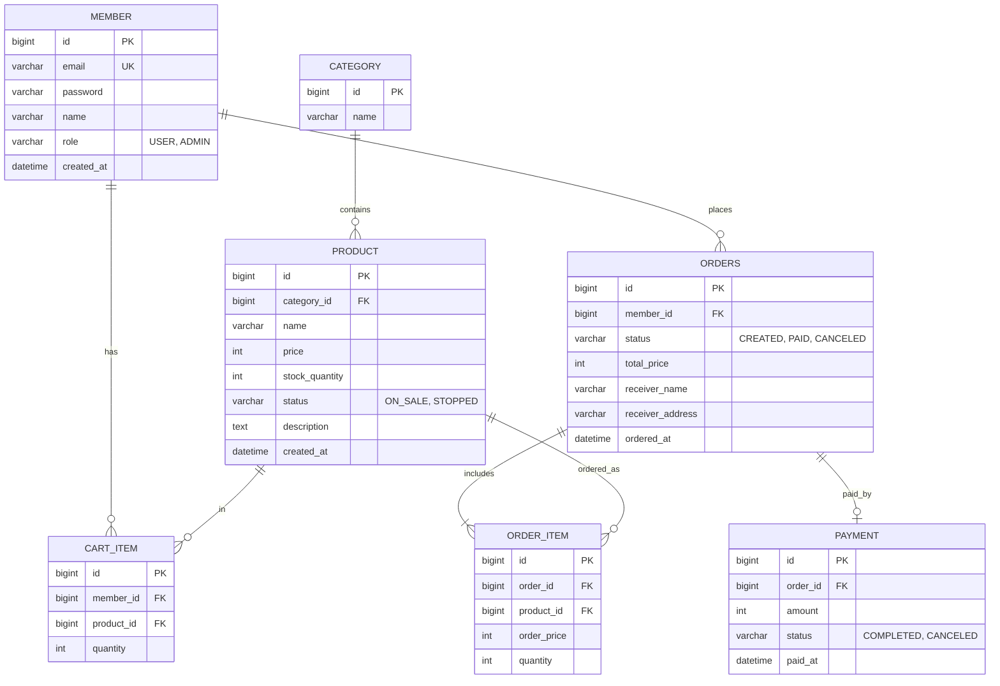

# 쇼핑몰 백엔드 설계서 (MVP v0.3)

기술 스택: Spring Boot 4.x (4.0.9) / Java 17 / Spring MVC / MyBatis / MySQL 8 (로컬 설치) / Gradle
인증: 쿠키 + 세션, 인터셉터 (MVP 단계에서는 Spring Security를 사용하지 않음)
API 테스트: Postman (컬렉션을 export해 저장소에 포함)

원칙: 이미 배운 내용(MVC 1·2, DB 1·2) 안에서 실제로 필요한 기능만 쓴다. 필요하지 않은 기술은 억지로 넣지 않는다.

## 1. MVP 범위 (핵심만)

| 영역 | 기능 |
|---|---|
| 회원 | 회원가입, 로그인/로그아웃, 내 정보 조회 |
| 상품 | 카테고리별 상품 목록(페이징), 상품 상세, 상품 등록/수정 (관리자) |
| 장바구니 | 담기, 수량 변경, 삭제, 조회 |
| 주문 | 장바구니/단건 주문 생성, 주문 목록/상세, 주문 취소 |
| 결제 | 모의 결제 (외부 PG 연동 없이 상태만 변경) |

MVP 제외 (이후 확장): 리뷰, 쿠폰, 배송 추적, 관리자 통계, 소셜 로그인, 재고 동시성 제어(확장 단계에서 도전)

## 2. 도메인 규칙

- 주문 시 상품 재고를 차감한다. 재고가 부족하면 주문 실패.
- 주문 상태: `CREATED` -> `PAID` -> `CANCELED` (결제 전/후 취소 모두 가능, 취소 시 재고 복구)
- 주문 시점의 상품 가격은 `order_item.order_price`에 복사 저장한다. (상품 가격이 바뀌어도 과거 주문은 유지)
- 비밀번호는 평문으로 저장하지 않는다. `spring-security-crypto`의 `BCryptPasswordEncoder`만 단독으로 사용한다. (Spring Security 전체를 도입하는 것이 아님)
- 상품 삭제는 물리 삭제 대신 `status`로 판매중지 처리한다.

## 3. ERD



참고: `order`는 SQL 예약어라 테이블명을 `orders`로 한다. `cart_item`은 (member_id, product_id) 유니크 제약을 건다.

## 4. API 초안

| 메서드 | URL | 설명 |
|---|---|---|
| POST | /api/members | 회원가입 |
| POST | /api/login | 로그인 (세션 생성, 쿠키 발급) |
| POST | /api/logout | 로그아웃 (세션 만료) |
| GET | /api/members/me | 내 정보 |
| GET | /api/products?categoryId=&page=&size= | 상품 목록 |
| GET | /api/products/{id} | 상품 상세 |
| POST | /api/admin/products | 상품 등록 (관리자) |
| PUT | /api/admin/products/{id} | 상품 수정 (관리자) |
| GET | /api/cart | 장바구니 조회 |
| POST | /api/cart/items | 장바구니 담기 |
| PATCH | /api/cart/items/{id} | 수량 변경 |
| DELETE | /api/cart/items/{id} | 삭제 |
| POST | /api/orders | 주문 생성 |
| GET | /api/orders, /api/orders/{id} | 주문 목록/상세 |
| POST | /api/orders/{id}/cancel | 주문 취소 |
| POST | /api/orders/{id}/pay | 모의 결제 |

## 5. 패키지 구조 (도메인형)

```
com.example.shop
 ├─ member     (controller, service, mapper, domain, dto)
 ├─ product
 ├─ cart
 ├─ order
 ├─ payment
 └─ global
     ├─ web        (LoginCheckInterceptor, AdminCheckInterceptor, LoginMemberArgumentResolver)
     ├─ exception  (ErrorCode, 커스텀 예외, ApiExceptionHandler)
     └─ config     (WebMvcConfig 등)
```

MyBatis Mapper XML은 `resources/mapper/{도메인}/` 아래에 둔다.

## 6. 배운 내용이 실제로 쓰이는 지점

| 필요한 기능 | 사용하는 기술 (강의) |
|---|---|
| 로그인 상태 유지 | HttpSession, 쿠키 (MVC 2편) |
| 로그인 안 한 사용자 차단, 관리자 권한 체크 | 인터셉터 (MVC 2편) |
| 컨트롤러에서 로그인 회원 꺼내기 | ArgumentResolver, `@Login` 애노테이션 (MVC 2편) |
| 요청 값 검증 (이메일 형식, 수량 1 이상 등) | Bean Validation (MVC 2편) |
| API 오류를 공통 JSON으로 응답 | `@RestControllerAdvice`, `@ExceptionHandler` (MVC 2편) |
| 쿼리 작성, 동적 검색, 페이징 | MyBatis (DB 2편) |
| 주문 생성 시 여러 변경을 한 번에 처리 | `@Transactional`, 롤백 (DB 2편) |
| 데이터 접근 계층 분리 | Repository/Mapper 인터페이스, 예외 변환 (DB 1·2편) |
| 요청/응답 JSON 처리 | `@RequestBody`, `@ResponseBody`, ResponseEntity (MVC 1편) |

## 7. MyBatis 사용 시 신경 쓸 점

- 연관관계 자동 매핑이 없으므로 조인 쿼리와 `resultMap`을 직접 작성한다. (주문 조회: orders + order_item + product)
- UPDATE 쿼리를 명시적으로 작성한다.
- `@Transactional` 범위를 서비스 계층에서 명확히 잡는다. (주문 생성: 재고 차감 + 주문 저장 + 장바구니 비우기가 한 트랜잭션)
- 스키마는 `schema.sql`로 관리한다. 개발 단계에서는 앱 실행마다 `DROP TABLE IF EXISTS` 후 다시 생성한다. (필요해지면 Flyway 검토)
- 설정은 `application.yml`에 둔다. MyBatis는 `mybatis.configuration.map-underscore-to-camel-case: true`로 설정한다.
- Mapper 통합 테스트는 로컬 MySQL의 `shop_test` 데이터베이스를 사용한다.

## 8. Postman 테스트 방법

- 환경 변수 `baseUrl`을 만들어 `http://localhost:8080`으로 설정한다.
- 로그인 요청 후 응답의 `Set-Cookie: JSESSIONID`를 Postman이 자동 저장하므로, 이후 요청에 세션이 유지된다.
- 폴더 구성: 회원 / 상품 / 장바구니 / 주문 / 결제. 정상 케이스와 실패 케이스(재고 부족, 미로그인, 검증 오류)를 함께 둔다.
- 완성한 컬렉션을 JSON으로 export해 저장소의 `docs/postman/`에 커밋한다.

## 9. 개발 로드맵

1. 환경 세팅: 프로젝트 생성, Git, 로컬 MySQL(`shop` 데이터베이스), CLAUDE.md
2. 공통 기반: 응답/예외 포맷, ApiExceptionHandler
3. 회원: 가입, 세션 로그인/로그아웃, 로그인 인터셉터, `@Login` ArgumentResolver
4. 상품/카테고리: 조회 + 페이징, 관리자 등록 (관리자 인터셉터)
5. 장바구니
6. 주문/결제: 트랜잭션, 재고 차감, 취소
7. 테스트: 서비스 단위 테스트, Mapper 통합 테스트
8. 확장 (선택, 필요성이 생기면 새로 학습해서 도입)
   - 인증을 Spring Security로 전환: 직접 만든 세션/인터셉터 방식과 비교하며 전환 (세션 유지 또는 JWT)
   - 배포: 앱을 Docker 컨테이너로 만들어 서버에 배포 (Docker는 이 단계에서 처음 학습, 필요하면 docker-compose로 MySQL까지 구성)
   - 재고 동시성 제어 (비관적 락 vs 낙관적 락), 캐시(Redis)

## 10. 미정 사항

- 없음 (인증은 세션, DB는 로컬 MySQL, 테스트는 Postman으로 확정)
